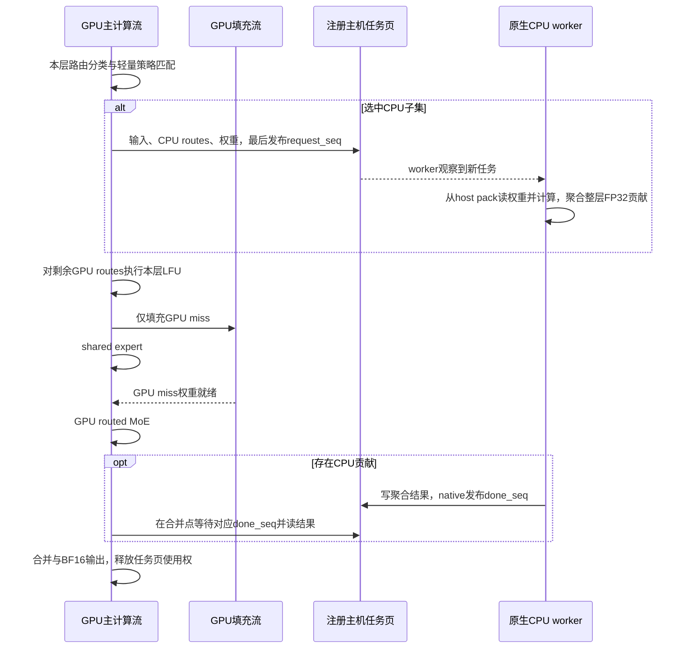

# 分层 LFU 上的 CPU/GPU 共算设计

日期：2026-10-22。本文主体保留初版设计；实现与验证进展见下方更新及验收报告。

## 成本分桶更新

分层决策新增 schema 4，借鉴全局 cache 的工作量查表和候选前缀选择，不引入全局 LFU、热度准入或跨层 victim。原 schema 3 的精确键仍可读取，表仍与源码、CPU 库、硬件和执行配置绑定。

- key 保留 M、top-k、有效 route 总数、active 专家数、shared-fill overlap，以及全部 miss 专家的 `(distinct tokens, route count)` 有序分布。选定前缀后，CPU route/expert 数、GPU route/expert 数和 GPU fill 数由此确定。
- 层号、槽位容量、专家 ID 和逐 token 的具体路由掩码不再构成成本 key。不同层与容量可复用测量；实际 GPU LFU 和槽位安全检查仍在原层执行。CPU 候选按 `(distinct tokens, route count, expert ID)` 排序，优先较小工作量。
- CUDA 通过 64 位 hash 二分查表，再比较完整规范化 key，避免 hash 碰撞授权分流。未知工作量、未知 overlap、容量不足和 B12X 无安全 GPU route 时回退零分流。
- 一个桶至少需要三个真实代表。本次标定选三个不同层，每个 CPU 前缀 4 次预热、15 对随机交错测量；全部代表均通过中位数节省 >5us 且 >5%、P95 改善及至少 12/15 胜率，才授权共同最快的获利前缀。
- 标定基线为原始 GPU planner/fill/B12X BF16 输出，涵盖新路径 FP32/merge 的额外开销。具体层/容量/路由样本及完整配对保存在新证据目录 `layered_bucket_20261022`。分桶是成本近似；跨代表仍有波动，须用独立无采样服务对比验证整体收益。

初版设计基线：`9321a3f4504534811676c4d1f39d62341089e610`。以下主体记录当时的设计约束与备选方案；当前实现和测量以成本分桶更新及验收报告为准。

## 1. 已确认的目标与边界

1. 保留原有逐层 GPU cache、逐层 LFU victim 规则和低频跨层容量 rebalance。底层可以共用物理显存池，但每次调用只能分配/淘汰本层拥有的 slot。
2. miss 只是 CPU 候选。默认全部走 GPU，只有测得能缩短整层完成时间的子集才走 CPU。允许选零个，不固定 CPU 比例或专家数。
3. CPU 专家本次不搬任何权重到 GPU、不分配 slot、不触发 GPU cache 淘汰，也不在后台补入。只传输入和聚合计算结果。未来调用可以重新决定走 GPU。
4. 不引入全局 LFU 的热度准入、rejected、跨层 victim 堆及全局频率扫描。
5. 避免每层 CPU/GPU 决策往返，避免每专家交互，减少结果同步之外的等待。
6. 首版支持现有 target W4A16/B12X、BF16 激活、M=1..3、top-k<=10、单 GPU/单请求有序执行。prefill、draft、其他 backend/并发形态沿用原有路径；扩大范围要重新验证。

“保持 LFU”指保持 GPU 缓存更新算法，不要求启用 CPU 后的缓存内容与全 GPU 完全相同。CPU bypass 改变后续驻留集合是预期行为。

## 2. 决策在哪里：本设计的实现选择

CPU 是否参与，不是架构上必须由 GPU 决定。这里选择：CPU 离线/启动阶段产生策略；GPU 利用本来就有的实时路由和 lookup，执行有界的子集匹配。理由是输入与 cache 状态已经在 GPU，避免增加 `GPU路由→CPU决定→GPU接收决定` 这一条同步依赖。

这只是一个轻量执行点，不能借此搬入全局规划逻辑。实现者若改为原生 CPU 在线选择，需要提供时序和对照，证明不增加决策等待、重复计算或不一致的分区。

策略表在启动时上传，首版服务期间只读。不为每层做 CPU busy 状态查询。单有序模型链在消费当前 CPU 结果后才进入后续依赖层，不维护跨层 CPU 任务积压。支持多条独立模型链时另行设计容量/队列协议。

关闭分层共算或不存在适用校准表时，启动时直接选择原分层 GPU 路径，不创建无用的轮询 worker。开启但本次选零个 CPU 专家时，没有任务发布和结果等待，但可能仍有分类、FP32 输出转换及空 merge 的固定开销；必须测量，不承诺为零。

## 3. 每层执行流程

设原始有效专家集合为 U，调用开始时的驻留 hit 集合为 H，miss 集合为 M。按 expert ID 去重，保留每个专家涉及的 token 和 route 权重。

1. 等待本层此前使用与布局变更所需的既有事件，取得当前稳定 lookup/slot 视图。
2. 在现有 decode 路由处理中得到 H/M 和 token 分布。用小型策略表比较 CPU 子集 C（含空集）。只有 C 是 M 的子集；GPU 处理 H 与 M\C。
3. 选定 C 后发布一次 CPU 请求。请求的正确性只依赖原始激活、ID、权重和分区，不依赖随后 LFU victim 选择，所以在同一个规划 kernel 内可先发布，再处理 GPU miss 的局部 LFU。不能为了提前发布新增一次强制 host 同步。
4. 仅对 GPU 路由执行原分层 LFU，得到 remapped GPU IDs 和 GPU fill plan。CPU 路由在 GPU IDs 中标记为屏蔽值，不出现在 fill plan 中。
5. GPU 按原 transport 填充 M\C，可继续与 shared expert 重叠；随后执行一次 GPU routed MoE。CPU 同时从同一 host pack 读取 C 的权重，一次处理本层全部 CPU 专家。
6. CPU 将所有专家的加权贡献归并到一个 FP32 `[M, hidden]` 结果，直接在 native 中发布完成。
7. GPU routed 结果就绪后，在合并点检查本次是否有 CPU 贡献。有则消费对应序号结果，无则不读取 host completion/result。FP32 相加后只做一次 BF16 转换。
8. GPU 消费完 CPU 结果及全部输入引用后，才能复用这次任务的映射页/输出缓冲。进入后续依赖层。

第一版不额外拆分 resident-hit 与 GPU-miss 两次 routed MoE；保留一次 routed 计算，避免多一次 launch、部分结果缓冲和合并。已有 early-cache 实验路径先与新共算互斥，后续单独校准组合收益。

图中跨参与者箭头是逻辑依赖，不表示每条都提交 CUDA memcpy/event。任务和结果可通过已注册映射页直接读写。

## 4. 分层 LFU 的精确状态规则

### 4.1 三种路由

| 路由 | GPU LFU状态 | GPU权重传输 |
|---|---|---|
| 原来驻留的 hit | 按原规则更新 frequency、age；本次活跃保护 | 无 |
| miss且选GPU | 按原规则选择空slot/victim、更新lookup/keys/generation/frequency/age | 恰好一次正常fill |
| miss且选CPU | 不创建映射、不改变任何slot的所有者、不因该专家执行替换 | 零，包括后台补入 |

调用级 resident frequency 衰减仍执行一次；GPU 专家按原 expert ID 顺序处理，frequency 增量、age/clock、generation 和 tie break 保持原算法。CPU expert 不存在 slot，因此没有对应的 slot 热度增量或 clock/age 访问更新。

定义参考行为：从同一个真实 cache 初态出发，将选中 C 的 route 替换为屏蔽值，在原分层 LFU 算法上执行一次，得到本次 GPU 状态期望值。C为空时逐字段等同原分层算法；C非空时比较这个过滤后的参考，而不是与全GPU路径比较cache完全一致。

原始路由用于需求采样和rebalance，过滤后的路由用于GPU驻留维护。不能用 CPU 分流后的miss计数伪装需求减少。日志区分 `original_miss_experts`、`cpu_experts`、`gpu_fill_experts`。

### 4.2 容量与回退

首版只在原分层GPU路径可处理的容量/形状范围启用，不能依靠CPU分流使原本超容量的调用可执行，否则C=0回退可能失败。原来的arena/大batch回退仍有效。

CPU实际算错或超时后，不能直接把已经屏蔽的GPU路由当成完整输出，也不能在已有任务进行时无协议地重新路由。初始化前发现CPU/校准不支持，可回退GPU；发布后故障沿现有poison/watchdog终止请求，保留资源直到读写方退出。

## 5. 子集选择与成本校准

### 5.1 候选和查表

所有 miss 都可作为候选，不使用全局LFU rejected。首版按 `(本专家涉及的token数, expert_id)` 确定稳定排序，评估有界的前缀 C_k。k=0 始终有效；最大k由实现上限和本机测量确定，不直接固定为3，也不默认把全部miss交CPU。

前缀搜索是降低在线成本的近似，不宣称全子集最优。必须按实际token占用编码，而不只统计route数量：M<=3时可记录每个候选的token mask以及重复route分布，或在校准中证明更粗的键足够保守。

建议查表字段：M、top-k、原始distinct miss数、CPU候选token分布、剩余GPU fill数/字节、GPU活跃route/专家数，以及经测量必要的层/容量/布局桶。策略元数据绑定backend、权重格式、GPU/CPU、物理核数、transport、数值路径、源码/库指纹。不要复用全局方案的校准文件；它的缓存规划和分支成本不同。

GPU fill数量/字节按 C_k 确切计算，不能从“GPU route数”推断；GPU routes包含hit。表为有界索引/稀疏桶，不能每层线性扫描所有校准样本。表缺失/分布未知选择C=0。

### 5.2 盈利标准

在同一个cache初态、同一层路由、同一输入下配对测：

`T0 = 原分层GPU规划 + fill/shared重叠 + GPU routed + 原输出路径`

`Tk = 新路由/LFU开销 + max(CPU完整分支, GPU剩余分支) + 合并开销`

公式仅用于解释依赖，验收必须用完整分支elapsed，不能直接相加重叠kernel时间。CPU完整分支包含输入传输、领取、线程调度、计算、结果可见；GPU分支包含实际fill、shared竞争、masked路由执行和输出。

先选最短Tk，再要求比T0节省相对与绝对余量，并通过P95稳定性门槛。阈值由测量确定，不能拿以前全局方案的5%当自动默认。还要测“新框架但C=0”的固定损耗。单分支获胜不保证持续请求获胜，因为bypass改变未来cache；必须做连续路由和完整服务对照。

首版不新增CPU专家热度表。若重复bypass导致持续收益恶化，先用连续回放定位，再单独设计复用信号；不能为了这个问题偷偷后台预取CPU专家或恢复全局频率规划。

## 6. GPU/CPU协议与缓冲生命周期

### 6.1 热路径交互预算

| 情况 | GPU→CPU | CPU→GPU | GPU等待 |
|---|---|---|---|
| 共算关闭 | 无 | 无 | 原GPU依赖 |
| 共算开启但C=0 | 无任务发布，不搬激活 | 无 | 不查CPU completion/result |
| C非空 | 一份本层任务：激活、CPU routes、路由权重、layer/M/序号 | 一份整层聚合FP32结果和完成序号 | 仅在真正消费CPU结果时等待 |

这里的一份是逻辑任务/批量传输，不代表只发生一个PCIe事务。不得按专家逐个发任务、逐专家返回结果，或先读回完整LFU状态让CPU再决定。

首版复用注册mapped page，GPU直接写请求、CPU直接写结果。也可测一次成批DMA方案；以端到端和并发流量选择，不因调用数量少就断言更快。输入可先传完整小batch，首版避免动态gather引入额外kernel；进一步按被选token压缩需独立测量。

### 6.2 描述符

请求包含：版本、sequence、layer、M/top-k、CPU专家/route标记、BF16 activation、FP32 route weights。结果包含：对应sequence、FP32 `[M,hidden]` 聚合贡献、status/failure。固定上限预分配，地址稳定，启用时计入host/GPU内存预算。

旧 `state['plan']` 的 `[status, miss_count, active_count, arena]` 布局继续保留；不能像全局hybrid一样把 `plan[2]` 改成CPU专家数。CPU count/sequence/partition保存在独立的小描述符，fill/alpha scatter继续消费原格式。

### 6.3 发布、可见性与复用

状态为：`FREE → REQUEST_READY → CPU_RUNNING → RESULT_READY → GPU_CONSUMED → FREE`。

- GPU先写完payload，用现有经验证的system-scope发布方式最后写request sequence；CPU以匹配的acquire方式领取。不能仅假定普通host变量或volatile就保证payload可见。
- CPU完整写入result和status后，在native中发布done sequence；GPU必须采用已验证的映射内存读取/同步方式消费，不能依赖陈旧cache副本。
- 单个模型依赖链首版可共用一个任务页，但前一GPU消费者完成后才能让下一请求覆盖页。CPU在发布完成后不得再读该页输入或写结果；统计在局部副本上处理。涉及多个流时显式加入消费者完成依赖。
- 不把每层序号作为Python需要等待的结果。固定kernel/图节点可读取设备descriptor；不新增逐层`.item()`/event.synchronize来决定分支。
- CPU领取和完成都由持久native服务完成；一次任务调用一次批量执行入口，在一次团队dispatch内处理选中专家集合。不能仅把完成发布移入native而保留每专家唤醒协议。
- 持久worker的spin/park取舍需测量，prefill或服务空闲时允许停轮询；不宣称忙等零成本，也不在短decode任务间固定sleep 1ms。
- 多模型链、并发请求、多GPU不共享这个单页协议；需要每条链独立页或有界ring和容量控制，超出首版范围。

### 6.4 错误与退出

错误状态发布先于终止/完成通知，GPU消费者检查错误后失败，不能把旧result当本次结果。watchdog处理CPU退出、超时与GPU未消费；close/unregister只在native任务和GPU读写都退出后执行。sequence回绕需在完全drain后重置或采用有界不回绕类型，禁止依赖跨回绕大小比较。

## 7. GPU计算、mask和合并

首版使用GPU FP32部分结果与独立merge，复用验证过的数学路径：GPU处理H与GPU miss，CPU处理C，两者route集合不重不漏，原route权重各乘一次，最后统一BF16转换。不能先把GPU结果转换BF16再叠加CPU来冒充同一数值路径。

B12X对masked IDs的处理必须单独验证：不能假设传-1就一定不会读权重、alpha或越界。如果需要sentinel/zero storage，必须与所有可被LFU替换的slot隔离，并将占用算入预算；不能直接把每层slot 0当永久zero slot。优先使用有明确有效性检查的mask路径，首版不因共算扩大每层workspace到全模型专家数。

一旦启用设备侧动态分流，host并不知道当前C是否为空。首版允许固定FP32+merge路径，merge在C=0时只转换GPU输出、不访问host内存。额外launch/转换的成本必须纳入C=0和整服务验收；不能写成“没有CPU任务所以自动没有merge”。关闭功能才必须直接回到旧BF16路径。

不直接启用旧FC2融合等待实现；它曾有逐输出轮询退化。后续只有在确认等待和读取不重复、数值一致且C=0/混合路径都获益后才融合。也不为了跳过merge引入同步路由回读。

## 8. 与原有runtime的接入

采用单独的分层共算组件，不继承全局HybridCache的所有权与prefill调度。配置在loader/runtime边界解析一次，至少能明确区分既有全局实验模式、原分层GPU、分层共算；不要重解释旧布尔开关而让历史启动配置静默切换架构。确切配置字段名由实现者按仓库规范落定。

| 现有位置 | 接入职责 |
|---|---|
| `srt/layers/moe/qwen38_cache_mailbox.py::DecodeMissMailbox.run` | 保留事件池、fill、采样；增加分层共算descriptor及结果消费边界 |
| `kernels/jit/csrc/moe/qwen38_expert_cache.cu` | 在逐层路由/plan旁实现miss分类、轻量选择；复用逐层LFU规则，不改变旧plan ABI |
| `kernels/ops/moe/` | 分层共算kernel公开入口与懒注册，按完整算子契约组织 |
| `srt/layers/moe/` 新分层共算组件 | 生命周期、预分配、native worker、校准选择、统计；不得拥有跨层victim索引 |
| `kernels/ops/moe/cpu_nvfp4/` | 批量任务入口、原生领取/计算/发布；复用现有数值内核和host pack |
| `srt/layers/quantization/qwen38_nvfp4_cache.py` | 分离CPU执行能力与“存在global hybrid对象”的判断；分层模式走原cache和prefill分支 |
| `srt/layers/quantization/qwen38_cached_b12x.py` | 部分FP32输出与安全mask；workspace容量继续按逐层容量界限 |
| `srt/layers/moe/qwen38_cache_threaded.py` | 共算不应关闭原adaptive worker；维持layer_cache_slots、staged pool、arena和resize路径 |
| `srt/model_loader/qwen38_nvfp4_cache_loader.py` | 显式模式选择、能力与校准校验；未校准形状GPU回退 |

现有代码用 `runtime.hybrid is not None` 推导全局容量、prefill调度和resize入口；不能仅替换对象名后继续使用这些推导。prefill不做CPU分流，不创建全局ownership或全局LFU快照。缓存rebalance、KV resize、graph warmup切换流和关闭要drain所有受影响GPU读者/任务页消费者，重建受影响slot地址和校准容量桶。

## 9. 验证与验收

### 9.1 正确性

- 对C=0，逐层lookup/keys/frequency/ages/generation/clock与原算法逐字段一致。
- 对受控C，GPU状态与过滤后原LFU独立参考一致；CPU专家从未出现在GPU fill/alpha scatter列表，没有因CPU选择造成的slot变更。
- 检查GPU/CPU route不重不漏，duplicate专家跨token合并、重复route权重、全hit、全miss、C=0、策略允许的全CPU候选、非法ID、容量边界、tie break。
- 对同一输入比较FP32分支和最终BF16结果，沿用已批准的backend数值容差；不得为通过测试临时放宽。长生成/MTP还需正确性及接受率观察。
- 交替CPU/GPU、CPU→GPU加载、GPU→CPU淘汰后再选、连续复用任务页、C=0夹在两个CPU任务中、CPU延迟/错误/退出、sequence边界、跨流warmup与关闭。
- 开着adaptive rebalance和KV resize做短→长→短，验证完整原始路由采样、slot搬迁、图引用与缓冲区寿命。
- mask输入必须证明没有不合法权重/alpha读取；不能只看输出数值碰巧为零。

### 9.2 性能矩阵

固定模型、权重格式、GPU/CPU资源、总slot/metadata预算、输入、prefill chunk、KV阶段和图配置：

| 模式 | 目的 |
|---|---|
| A 原分层GPU | 用户实际性能基线 |
| B 分层共算框架，诊断强制C=0 | 量出选择、descriptor、输出转换和空merge固定成本 |
| C 分层共算，启用真实策略 | 对A测净收益，对B测CPU分担收益 |
| D 当前全局共算（可选） | 架构对照，不能代替A |

B是显式诊断模式，不得在空表时自动被优化回A后宣称零开销。正确性oracle和微基准可用录制固定路由；完整服务必须独立运行自己的连续cache轨迹，同时报告MTP接受率与ms/sweep，不能只看tok/s。

每层聚合记录：CPU选择率、候选数、原始miss、GPU fill专家/逻辑字节、CPU调用数、CPU处理专家数、request发布→领取、CPU计算、结果发布→GPU消费、暴露等待、planner/fill/merge耗时及P50/P95/P99。热路径用有界native/device记录，窗口后读回；不开逐层Python打印。实际节省的搬运不能只计算当前CPU专家数，还要计后续miss/reload和cache状态变化。

交错A/B/C多轮，服务重启与预热一致，包含短decode、自然聊天、长输入后decode、全hit与多miss分布。校准时间与服务测量分开；使用重复测量区间而非最好单次。性能验收要求C对A有可重复净收益，B固定损失足够小，长prefill和生命周期无不可接受回退。具体阈值在基线噪声测出后预先记录，不写未经测量的加速承诺。

## 10. 推荐交付顺序

1. 先做模式解耦和A/B：新模式仍用逐层cache，C固定为空，证明状态一致并量出固定开销。
2. 用受控CPU子集跑通原生任务协议与数值验证，证明CPU专家零权重传输、零slot插入，不开启自动策略。
3. 基于这条真实路径重新校准，加入小表选择，再做连续路由和A/B/C服务验收。
4. 根据证据压缩请求领取/发布、批量dispatch、C=0固定开销；之后才考虑更复杂候选、hit/miss分开执行或融合epilogue。

实现者交接时提交：生产补丁、独立LFU oracle结果、CPU/GPU数值结果、生命周期结果、校准及源码指纹、A/B/C原始测量、trace与分析。不得将全局分支的校准或历史trace冒充新设计的实测。
