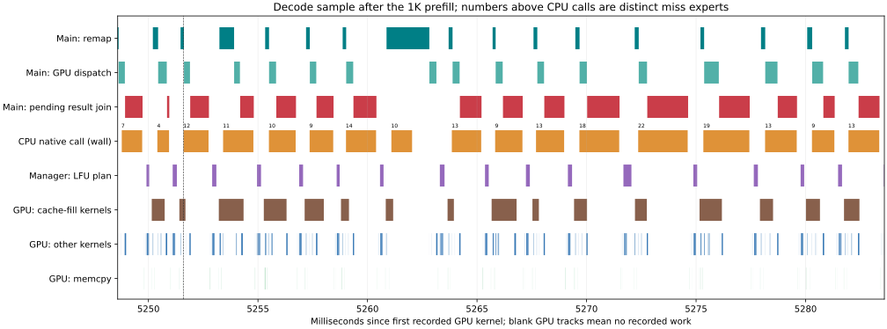

# CPU 共算与异步 LFU：耗时分析及 Nsight 交接

运行时代码提交：`f65e26e5abaaf705c6f4833dcc7e224dc0a8bb7e`；对照运行时：`1c44f941009071a6de1b2f0c1c7728198de45f5e`。

已实现空槽首次准入、满槽达到 Frequent（衰减频率 >= 1.9）再准入；冷 miss 留在 CPU。管理线程通过事件轮询等待读者和复制完成，计算线程使用不可变 survivor 映射，无需等待管理 Future。提交中的 README 解释准入、发布、resize 和关闭的安全边界。

实测专家后台填充字节减少 **42.4%**，但尚未获得稳定的短请求吞吐提升。当前主要矛盾是 CPU miss 增多后的 native 计算与结果等待，以及 prefill 路由读回等待 GPU 依赖。不能把所有同步 API 时间都解释成可直接消除的管理开销。

## 交接材料

- [baseline 原始 Nsight](captures/baseline.nsys-rep)、[异步版原始 Nsight](captures/async.nsys-rep)、[详细探针原始 Nsight](captures/detailed.nsys-rep)。均为完整二进制报告，可直接用 Nsight Systems 打开。
- [capture-manifest.json](capture-manifest.json)：文件大小、SHA256、版本和代码来源。每份报告旁保存启动日志、请求结果和函数标注配置。
- [timing-analysis.json](timing-analysis.json)：完整 NVTX inclusive/exclusive、分位数、线程归属、CUDA API、kernel、copy、CPU miss 专家数及逐层统计。
- [comparison.json](comparison.json)、[performance.json](performance.json)、[lifecycle.json](lifecycle.json)：无 profiler 的端到端结果和生命周期验证。
- [analyze_handoff.py](analyze_handoff.py)、[profile_hooks.py](profile_hooks.py)、[launch_profiled.py](launch_profiled.py)、[plot_handoff.py](plot_handoff.py)：可复核分析和显式启用的探针。生产服务不导入这些探针。

## 实验口径

RTX 5090 D、Ryzen 9 9950X，CPU 四核（0–3）、TP=1、并发 1；本地 Qwen3.8 FlashNext FP4，模型 revision `b9ce18a6887e18c089fdea8509a33e63429a3300`。48 层、top-k=8、MTP 两步，verify 的 CPU 输入 M=3。Nsight Systems `2026.3.2.476-263238834031v0`。

采集前完成 warmup 和算术 42 检查；采集请求是 16K+64 salt 输入生成 8 token，随后 1K+64 salt 输入生成 256 token。详细探针的客户端耗时为 4.4551 / 6.0799 秒；轻探针异步版为 4.3920 / 5.7656 秒，对照为 4.8716 / 5.4325 秒。探针改变开销，MTP 接受率及路由也可能不同；这些单次采集不能代替无 profiler 吞吐对比。

下面的累计 host 时间可能跨线程重叠，父子 scope 也有包含关系，不能直接相加。GPU busy 指至少一个已记录 kernel/copy 活动存在，**不是 SM 利用率**。没有采集 CPU 指令采样，native wall time 包含协调线程等待工作线程，不能当作纯数学运算时间。

## 无 profiler 的结果

| 指标 | 对照 | 异步最终版 |
|---|---:|---:|
| 短请求 median tok/s | 63.64 | 61.50 |
| 短请求范围 tok/s | 58.92–64.00 | 61.39–66.07 |
| 自然文本 tok/s | 51.88 | 59.75 |
| 170K TTFT，秒 | 37.456 | 33.408 |
| resize 后 tok/s | 64.50 | 60.56 |
| 后台专家填充字节 | 536.895 GB | 309.191 GB |
| CPU 调用数 | 19,380 | 47,003 |
| CPU miss 专家数 | 29,578 | 182,427 |

第一次异步版短请求为 65.75 tok/s，说明目前波动下不能声称稳定加速。最终性能测试曾短暂与诊断 SQLite 查询重叠，也限制了速度结论的置信度。旧版 eviction 统计漏掉 immediate 路径，不能直接比较两版 eviction 数。

永久预留 arena 的容量代价是 512 槽及 B12X slot zero：物理 7006 / 6643 / 6388 槽对应可用 6493 / 6130 / 5875。应另做容量一致的 A/B，尚不能认定它导致 resize 后回退。完整 benchmark 后两版都没有零 ownership 层；不要把该现象推断为零槽饥饿。

## 轻探针对照

| 指标 | baseline | async |
|---|---:|---:|
| GPU 活动窗口，秒 | 10.300 | 10.153 |
| kernel/copy busy 占比 | 62.24% | 60.30% |
| 无 GPU 活动，秒 | 3.889 | 4.030 |
| CPU wrapper 调用 / 累计秒 | 1765 / 0.413 | 4634 / 2.372 |
| remap host，秒 | 0.429 | 0.730 |
| GPU dispatch host，秒 | 0.982 | 1.244 |
| manager plan，秒 | 0.463 | 0.486 |
| cudaEventSynchronize 次数 | 32,358 | 5,443 |
| cudaMemcpyAsync 次数 | 141,011 | 155,064 |

事件同步次数下降约 **83.2%**，但 CPU 路由读回和结果上传增加了 memcpy 消息。同步减少已经发生，计算与通信总开销仍需继续优化。旧版 `_wait_arena` inclusive 约 2.238 秒，与父 scope 和其他线程重叠，不能直接视作净加速空间。

## 详细探针：主要 host 耗时

| scope | 次数 | 累计秒 | p50 / p95，微秒 | 解释 |
|---|---:|---:|---:|---|
| HybridCache.run | 5568 | 4.2737 | 649 / 1583 | exclusive 0.9604 秒 |
| remap | 5568 | 0.7970 | 113 / 232 | 路由 host 提交 |
| GPU dispatch | 5568 | 1.3250 | 225 / 337 | host launch 时间 |
| CPU result join，pending | 3605 | 1.1779 | 228 / 1007 | 其中 0.9654 秒没有 GPU 活动 |
| CPU result join，ready | 1963 | 0.0025 | — | 与 pending 合计 5568 次 |
| CPU input wait | 5568 | 0.1468 | 20 / 39 | 其中 GPU idle 0.0410 秒 |
| CPU native | 4972 | 2.4324 | 388 / 1113 | GPU busy 重叠 0.5162 秒，idle 1.9162 秒 |
| prefill | 192 | 3.3517 | — | exclusive 1.5987 秒 |
| prefill ids.cpu() | 192 | 1.7482 | 7204 / 23476 | GPU busy 重叠 1.6762 秒 |
| manager submit_ready | 23629 | 0.9966 | — | exclusive 仅 0.0691 秒 |
| manager plan | 5760 | 0.5261 | — | submit_ready 子 scope |
| manager copy | 4367 | 0.4015 | — | submit_ready 子 scope |
| manager complete_copies | 23629 | 0.0498 | — | 事件轮询 |
| begin_layer | 5760 | 0.0812 | 13 / — | 无管理 Future 阻塞 join |
| stats_snapshot | 45 | 0.0157 | 246 / — | 含 mailbox.flush_stats 0.0136 秒 |

CPU native 占 CPU wrapper 约 98.6%（wrapper 2.4669 秒），p99 1713 微秒、最大 5943 微秒。源码每个 distinct expert 顺序执行两次 Workers.dispatch；协调线程的条件变量等待包含有效工作线程运算。下一步需要区分解量化、GEMV、两次派工、线程唤醒和调度成本。

prefill ids.cpu() 内 memcpy API 累计约 **1.7371 秒**，对应设备 D2H copy 只有约 **0.0015 秒**。主要是读回所等待的 GPU 依赖及驱动行为，不能当作 PCIe 带宽问题；它已经包含在 prefill 3.3517 秒中。

管理线程 **没有 Synchronize API 调用**。其 cudaEventDestroy 4367 次共 0.4549 秒，p50 0.53 微秒、p99 6796 微秒；其中 0.4484 秒与 GPU 活动重叠。可检查事件生命周期及 profiler/驱动尾延迟，但不能声称可直接省掉 0.45 秒。

stats_snapshot 仍会 flush mailbox、等待层事件并读回 hit_stats，有异步清理空间，但实测仅 15.7 毫秒。主线程 outside_hybrid 的 cudaStreamSynchronize 222 次约 **0.4687 秒**，尚需定位 sampling/结果处理等调用点；不能归因于上述 stats。

## CPU miss 专家数与 native 延迟

全部为实际 verify **M=3**，E 为 distinct CPU miss 专家数。

| E | 样本数 | p50，微秒 | p95，微秒 |
|---:|---:|---:|---:|
| 1 | 836 | 213 | 282 |
| 2 | 869 | 278 | 386 |
| 3 | 819 | 364 | 476 |
| 4 | 666 | 453 | 586 |
| 6 | 361 | 633 | 784 |
| 8 | 195 | 820 | 1062 |
| 12 | 50 | 1181 | 1568 |
| 16 | 24 | 1632 | 1880 |

延迟随专家数明显增长。优先尝试跨专家批量派工、减少两段计算之间的线程协调，并用同样 M/E 分布验证，避免用单 token 微基准替代实际 verify。

## GPU 与传输

详细采集活动窗口 10.5317 秒，kernel/copy union 6.2279 秒（59.14%），无活动 4.3037 秒。kernel 累计时间 4.3923 秒；kernel union 3.9579 秒、copy union 2.3493 秒，存在重叠。

| kernel 类别 | 次数 | 累计秒 | kernel 累计占比 |
|---|---:|---:|---:|
| mailbox_fill_kernel | 4381 | 1.0610 | 24.16% |
| dense Mxfp8 GEMM（false 分支） | 5136 | 0.4418 | 10.06% |
| grouped NVFP4 prefill MoE | 2194 | 0.3553 | 8.09% |
| Qwen38SmallMDirectFp32 B12X | 5568 | 0.3455 | 7.87% |
| Mxfp8 GEMM（true 分支） | 23664 | 0.3285 | 7.48% |

SmallM GPU kernel 平均约 62 微秒，而相应 host dispatch 的 p50 为 225 微秒。需要结合依赖与时间线判断 launch 优化收益。

| copy 类型 | 字节 | 次数 | 设备累计秒 |
|---|---:|---:|---:|
| H2D | 110,739,400,412 | 134219 | 2.3136 |
| D2H | 125,844,792 | 17340 | 0.0205 |
| D2D | 15,829,107,308 | 9295 | 0.0153 |

mapped host 权重由 fill kernel 读取，不计入 CUPTI memcpy 字节，不能用此表代替专家填充字节统计。

## 时间线与建议顺序



图选 final prefill 后首个 E>=8 的 CPU 调用；窗口从 SQLite 时间戳 5.283872185 秒起，持续 35ms。数字为 CPU miss 专家数。PNG 和选择元数据一并提交。图中 CPU/native 为 wall time。

1. 先优化 CPU native 多专家执行和工作线程派工；以 pending result join 的 GPU idle 0.9654 秒为关键验证指标，不能把 native 2.4324 秒全部算成可回收时间。
2. 将 prefill 路由提取、unique、准入消息生产尽量留在 GPU 或采用批量异步读回，减少 ids.cpu() 的依赖等待；保留 copy 完成后发布映射的安全边界。
3. 减少逐层 remap 和 host GPU dispatch 的 Python/launch 开销，并检查主线程 outside_hybrid 的同步调用。结合 overlap 验证，不简单相加 host 时间。
4. stats flush 改成延迟消费事件和计数快照；它是真实遗留同步，但当前收益优先级较低。
5. 做容量一致、相同路由的策略 A/B，检查 Frequent 门槛、频率衰减和 churn。当前满槽替换选择本层较冷 victim，跨层通过空槽和冷释放共享；并非任意全局 victim 的即时替换。进一步全局竞争需要保留读者事件及跨层所有权安全。

## 复核

使用上述 Nsight 版本分别导出三个报告（SQLite 可再生，未提交）：

```bash
nsys export --type sqlite --output /tmp/baseline.sqlite captures/baseline.nsys-rep
nsys export --type sqlite --output /tmp/async.sqlite captures/async.nsys-rep
nsys export --type sqlite --output /tmp/detailed.sqlite captures/detailed.nsys-rep
python analyze_handoff.py baseline=/tmp/baseline.sqlite async=/tmp/async.sqlite detailed=/tmp/detailed.sqlite --output /tmp/timing-analysis.json
```

这些命令在本目录执行。重新采集使用上级 `nsight_optimization_20261021/profile_nsight.py --help` 所列参数，并加 `--detailed` 启用此次 Future/native/stats 探针；报告旁的 requests/functions JSON 和 server.log 保留实际参数与请求结果。原始报告完整 kernel 名称及相关性可在 Nsight GUI 进一步分析。

运行时提交之前已通过 73 个 CPU 注册测试、32 个 GPU PASS 检查（含 6 个真实 VMM 转换），以及长短请求 resize 生命周期和算术检查。本次交接只增加分析、探针和证据，未继续改动运行时代码。
