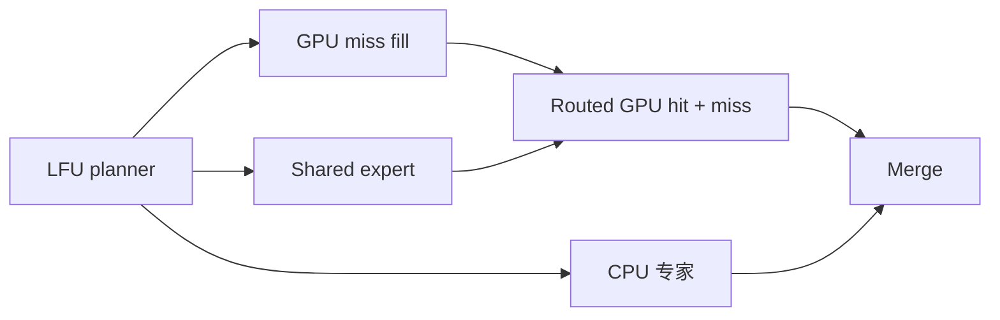

# 当前版本：共算与非共算 trace 对照

2026-10-23，源码提交 `cc57b1194e`，SGLang / Qwen3.8-Flash-Next FP4 / RTX 5090 D / Ryzen 9950X。本轮仅采集与分析，没有更改推理源码。

**主要结论：当前两个模式都以权重 fill 为最大的单项 GPU 活动；共算的 miss 覆盖率很低，GPU routed 计算也几乎没有缩短。CPU 完成等待在真实共算中可见，偶发约 2.13 ms 的 merge 长尾，但它的平均累计成本远小于 fill。**

## 对照与采样范围

使用相同 CPU-inclusive LFU 的 n=0、n=1，而不是把两种 cache 策略混在一起：

| 模式 | CPU 执行专家 | 独立 heat | GPU 输出 / merge |
|---|---|---|---|
| 原分层 GPU-only（off，本轮未重采） | 无 | 原 slot 频次 | 原 B12X BF16，无 hybrid merge |
| layered_lfu n=0 | 无；不启动 native CPU service | 有 | FP32 B12X + hybrid merge，descriptor CPU 数为 0 |
| layered_lfu n=1 | 符合规则的 miss；C>1 仍全 GPU | 有，包含 CPU route | FP32 B12X + CPU publication/service + hybrid merge |

因此 n=0 控制了共算框架的大部分固定开销，**不是原始 GPU-only 的同义词**。实际 cache 驻留与生成路线仍可能因分流、数值和 MTP 变化而不同，不是逐 route 相同的反事实实验。

首先按上轮 helper 的合成输入重采两组 24-step trace：发现 n=1 的整个请求序列 CPU 计数仍为 0，不能用它证明真实 CPU 支路的瓶颈。随后改用已执行过的真实 benchmark fixtures：预热 1088→128，短请求 1088→512，再自然聊天→512。两组均从独立新服务开始、相同 seed 和配置。

真实请求采样关闭 Python stack、保留 CPU/GPU activities；统计周期设为 576 runtime calls，用日志确认 CPU 工作确实发生。每个请求单独 start/stop profiler，去掉初始 prefill 与第一整个 decode/verify 轮，以后续 decode_plan_kernel 为边界分析。每组完整 decode 的层调用数不同，因为 MTP 接受率不同，所以用每层平均值比较。不是生产吞吐测试。

## Kernel table：完整 steady decode

单位为 **µs / decode layer 调用**。GEMM family 可包含每层多次 kernel，表格为累计时间除以 planner 数；不是每个 GEMM launch 的时长。各 stream 可重叠，不能简单相加成端到端耗时。

| 操作 | n=0 短 | n=1 短 | n=0 自然 | n=1 自然 |
|---|---:|---:|---:|---:|
| planner | 30.32 | 32.38 | 27.48 | 28.31 |
| mapped-host 权重 fill | 179.72 | 191.53 | 103.81 | 98.45 |
| routed B12X | 61.05 | 60.89 | 62.14 | 62.28 |
| MXFP8 GEMM（dense/shared 等） | 85.09 | 85.70 | 81.23 | 80.96 |
| BF16 GEMV + BF16 GEMM | 59.85 | 59.88 | 59.76 | 59.75 |
| hybrid merge | 1.51 | 2.35 | 1.50 | 1.84 |

fill 占各组累计 GPU kernel/memop 时间的 **24.22% / 34.95%（n=0）和 23.22% / 36.15%（n=1）**，为最大的单项。routed B12X 约 11%–15%；MXFP8 GEMM 约 16%–19%；planner 约 6%。这不是关键路径 wall-time 占比，也不是硬件利用率或 PCIe 饱和度。

fill 不是普通 cudaMemcpy 条目：它由 GPU SM 从映射主存读取权重并写入 GPU cache，所以只查看 H2D memcpy 会漏掉主要的 decode 权重访问。对耗时 >5 µs 的 fill（按时间分组，不直接当作 cache miss 标签），中位数约 **181 µs（短）/129 µs（自然）**；全 hit 的空 fill 很短，直接看所有 fill 的中位数会低估 miss 的代价。

MXFP8/BF16 GEMM/GEMV family 同样重要，并不会因少量专家改在 CPU 计算而消失。本轮没有 graph-off mapping trace，不能把 CUDA graph 内某个大型 GEMV 确定地命名为 lm_head，或把所有 MXFP8 GEMM 都称作 shared expert。

## 实际 CPU 覆盖与等待

以下日志计数器差值位于各自 profiler 请求内部，覆盖请求的大部分 decode，但不与完整 steady 区间严格一一对齐：

| 请求与模式 | runtime 层调用 | 原始 miss 专家 | CPU 专家 | CPU/miss |
|---|---:|---:|---:|---:|
| 短，n=0 | 10368 | 27200 | 0 | 0 |
| 短，n=1 | 9792 | 27361 | 277 | **1.012%** |
| 自然，n=0 | 11520 | 16554 | 0 | 0 |
| 自然，n=1 | 12096 | 16953 | 56 | **0.330%** |

计数满足 original misses = CPU experts + GPU fills。CPU 接走的比例很小，没有足够覆盖率去大幅减轻 fill。不能将 n=1 某组 fill 更少全部归为 CPU 直接绕过，也不能将短组 fill 更慢解释成 CPU 让 PCIe 变慢：route/miss 组成和 cache 轨迹存在变化。

| merge 指标 | n=0 短 | n=1 短 | n=0 自然 | n=1 自然 |
|---|---:|---:|---:|---:|
| median µs | 1.472 | 1.472 | 1.472 | 1.472 |
| p95 µs | 1.664 | 1.792 | 1.633 | 1.664 |
| 最大 µs | 2.080 | **98.560** | 2.112 | **2129.828** |
| >10 µs 的次数 | 0 | 279 | 0 | 59 |
| >10 µs 的累计时间 ms | 0 | 9.040 | 0 | 4.395 |

长 merge 的次数与 CPU 调用数在同一量级。结合 merge 对 CPU completion 的等待逻辑，可见 CPU 支路/完成发布有时晚于 GPU 支路，不能说 CPU 始终被 GPU 工作隐藏。反过来，有等待也不等于本次 offload 必然亏损：它可能仍少花了更多搬运时间，需要相同 route 的完整分支 A/B 才能判断净收益。

整体 merge 的累计占比仍不足 0.5%，所以它不是本轮平均吞吐的第一大瓶颈；2.13 ms 的孤立长尾值得查 native CPU 服务。当前 torch trace 不包含逐专家的 native AVX512 worker 细分，无法确认该长尾到底来自计算、线程唤醒/抢占、阶段屏障，还是完成信号可见性。不能直接将它归为 CPU 算术慢。

## Overlap-opportunity table

| 观察 | 证据 | 含义 |
|---|---|---|
| shared expert 已与 fill 重叠 | source 的 fill_with_overlap；日志 decode_shared_fill_overlap_invocations；GPU intervals 中 fill 与 MXFP8 GEMM 有交叠 | 不能说当前没有重叠。完整 trace 中 fill 与 MXFP8 family 的交叠时长约占 fill 的 7%–8%，这不是与所有 GPU 工作的总交叠比例 |
| routed hit/miss 仍绑在一起 | fill 完成事件后再运行 routed B12X | 未独立先算 resident routed hits；miss 访问仍会阻挡整次 routed 计算，是更大的流水线优化方向 |
| CPU 只接走极少 miss | 1.012% / 0.330% | 当前保守候选及 all-or-nothing 上限让 CPU 利用率很低，应按真实分支完成时间决定分流，而非仅增大 n |
| CPU 有可见完成等待长尾 | n=1 merge 最大 98.6 µs / 2.13 ms，n=0 最大约 2 µs | 优先加 native 时间标记拆 publication→service wake→compute→completion；不要只看所有 merge 的 p95 |

当前执行顺序可概括为下面的依赖关系；shared→routed 表示现有 compute-stream 顺序：

非共算 n=0 去掉 CPU 工作，仍保留当前框架的 merge。简化的共算关键路径近似受 `max(T_CPU, max(T_fill, T_shared) + T_routed) + T_merge` 约束；这只是依赖关系模型，还要考虑共享带宽、SM 争用与实际发布时间，不是用累计 GPU 时间直接代入的性能预测。

## Fuse-pattern table（人工复核）

| 项目 | 判定 |
|---|---|
| shared expert / fill overlap | 已存在且执行；主要缺口不是再加一遍 shared overlap，而是 resident routed hits 与 miss 的解耦 |
| C=0 的 FP32 输出与 merge | n=0 本身仍执行 FP32 B12X + merge，有固定代价；进一步消除需要 GPU 侧正确分支及一致的输出语义，不能靠 host 同步来抵消收益 |
| 通用 Qwen2 shared-expert / activation fusion 提示 | 技能自动三表保留，但不据此认定本模型可直接应用或把整组 GEMM 时间当作可节省时间 |

技能三表取每个完整请求中间的 24 个 decode 轮，完整聚合表则使用上述 steady 区间。窗口与完整请求的百分比可能不同。无 Python stack，因此 CUDA graph 内部的 Python source attribution 多为 unresolved；kernel family 与本地源代码交叉核对，不将自动提示当作已经验证的优化。

## 优先级

1. 平均吞吐：首先针对 fill 的暴露时间和 routed hit/miss 依赖，比较传输方式与流水线，并用实际字节/时间及硬件计数验证是链路、SM 发起的访问还是主存访问受限。
2. 共算：提高“CPU 完成时间能被 GPU 支路容纳”的有效分流覆盖率，同时减少无 CPU 工作时的判定成本。当前约 0.3%–1% 的 miss 覆盖无法支撑大幅整体加速。
3. 尾延迟：定位 native CPU completion 的 2 ms 长尾；它与平均 throughput 问题分开验证。
4. 普通线性层和 GEMV 仍占相当比例；需要 graph-off mapping 后才能进一步精确归因到模型模块。

原始完整 trace、窗口 trace、服务日志与请求输出均保存在本目录的 active-n0/、active-n1/ 下；本轮没有再次改动算法，也不从 profiler 下的请求速率推导生产吞吐。
